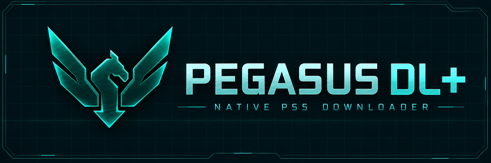

# Pegasus DL+

Browse catalogs, download files and install compatible packages directly on
your PS5, using your controller.

**[Download Pegasus DL+ 2.0.0](https://github.com/pegasus-ps5/pegasus-dl/releases/download/native-v2.0.0/PPSA99998.ffpfsc)**

## Features

- Browse and search catalogs, compare available versions and choose a download link.
- Open provider pages in the built-in browser and capture downloads.
- Manage the download queue, choose destinations, and extract supported archives.
- Connect Real-Debrid or TorBox, including account linking from your phone.
- Browse installed titles and manage files across mounted storage.
- Choose from ten languages, with localized keyboards and Arabic RTL support.

## Getting started

You'll need a homebrew-enabled PS5, a compatible ShadowMountPlus setup, and a
running ELF loader.

1. Copy `PPSA99998.ffpfsc` into your loader's homebrew folder.
2. Refresh the loader and launch **Pegasus DL+**.
3. Choose a download folder in Settings, review your catalogs in Sources, and
   start browsing in Store.

The app checks for updates at startup. Update preferences are in Settings.

Pegasus DL+ reports app launches and reliability diagnostics to help improve the app.

Thanks to **nexgen infinity** for testing Pegasus DL+.
